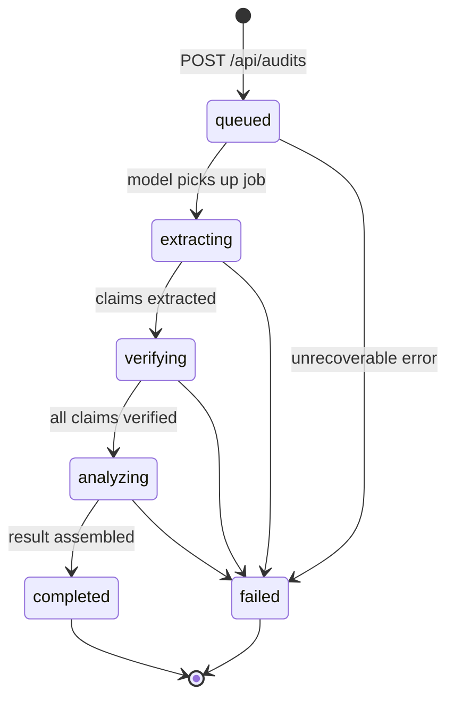

# Second Opinion — Architecture

## Overview

Second Opinion is a three-tier application:

| Tier | Service | Tech |
|------|---------|------|
| **Frontend** | React SPA (Vite) | React 18, TypeScript, Tailwind CSS |
| **Backend** | REST API + job runner | Node 20, Express, TypeScript, Mongoose |
| **Model** | NLP pipeline service | Python 3.11, FastAPI, Pydantic v2 |
| **Store** | Document database | MongoDB 7 |

---

## Pipeline Diagram

```mermaid
flowchart TD
    User(["👤 User"])
    FE["Frontend\nReact + Vite"]
    BE["Backend\nExpress / Node 20"]
    DB[("MongoDB")]
    MOD["Model Service\nFastAPI / Python 3.11"]

    subgraph NLP Pipeline [" NLP Pipeline (Model Service) "]
        direction TB
        CHUNK["POST /v1/chunk\nSplit sources into chunks"]
        EXTRACT["POST /v1/extract-claims\nIdentify claims in answer"]
        VERIFY["POST /v1/verify\nMatch claims vs. chunks"]
        ANALYZE["Analyze reasoning\n& safety flags"]
        CHUNK --> EXTRACT --> VERIFY --> ANALYZE
    end

    User -->|"Submit answer + sources"| FE
    FE -->|"POST /api/audits"| BE
    BE -->|"Persist job (status: queued)"| DB
    BE -->|"POST /v1/audit"| MOD
    MOD --> NLP Pipeline
    NLP Pipeline -->|"AuditResult"| MOD
    MOD -->|"AuditResult"| BE
    BE -->|"Update document (status: completed)"| DB
    FE -->|"GET /api/audits/:id (poll)"| BE
    BE -->|"Read result"| DB
    BE -->|"AuditResult"| FE
    FE -->|"Render highlighted answer"| User
```

---

## Status State Machine



---

## Service Communication

```
Browser
  └─► :3000  Frontend (Vite dev / Nginx prod)
               └─► :4000  Backend (Express)
                            └─► :8000  Model Service (FastAPI)
                            └─► :27017 MongoDB
```

All internal service-to-service calls use the **Docker internal network** (`second-opinion-net`).
Only ports `3000` and `4000` are exposed to the host during development.

---

## Environment Variables

Each service reads secrets from its own `.env` file (see `.env.example` in each folder).

| Variable | Service | Description |
|----------|---------|-------------|
| `MONGO_URI` | backend | MongoDB connection string |
| `MODEL_URL` | backend | Base URL of the model service |
| `PORT` | backend | HTTP port (default `4000`) |
| `OPENAI_API_KEY` | model | Key for LLM calls |
| `MODEL_MODE` | model | `mock` or `live` |
| `PORT` | model | HTTP port (default `8000`) |
| `VITE_API_URL` | frontend | Backend base URL seen by the browser |

---

## Data Flow: Character Offsets

All span offsets (`start`, `end`) are:
- **0-based** — first character of the string is index 0
- **End-exclusive** — `answer[start:end]` in Python / `answer.slice(start, end)` in JS
- **Anchored to the original answer** — never re-indexed after any transformation

See [CONTRACT.md](./CONTRACT.md) for full schema details.
